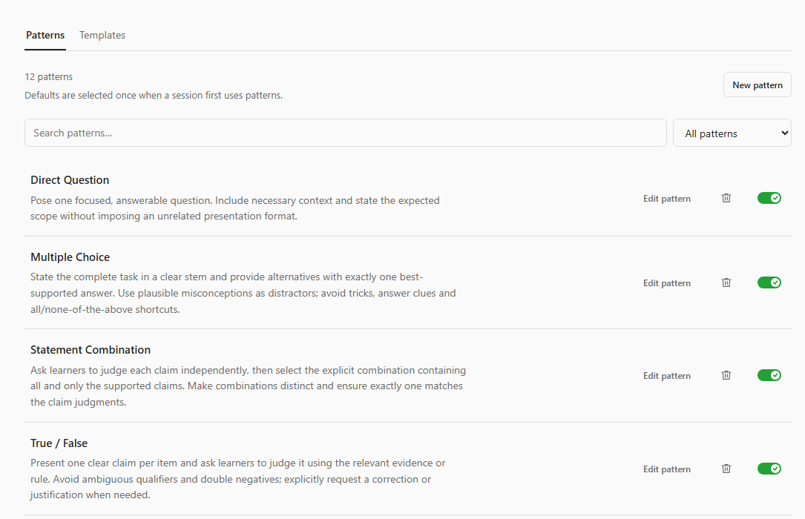
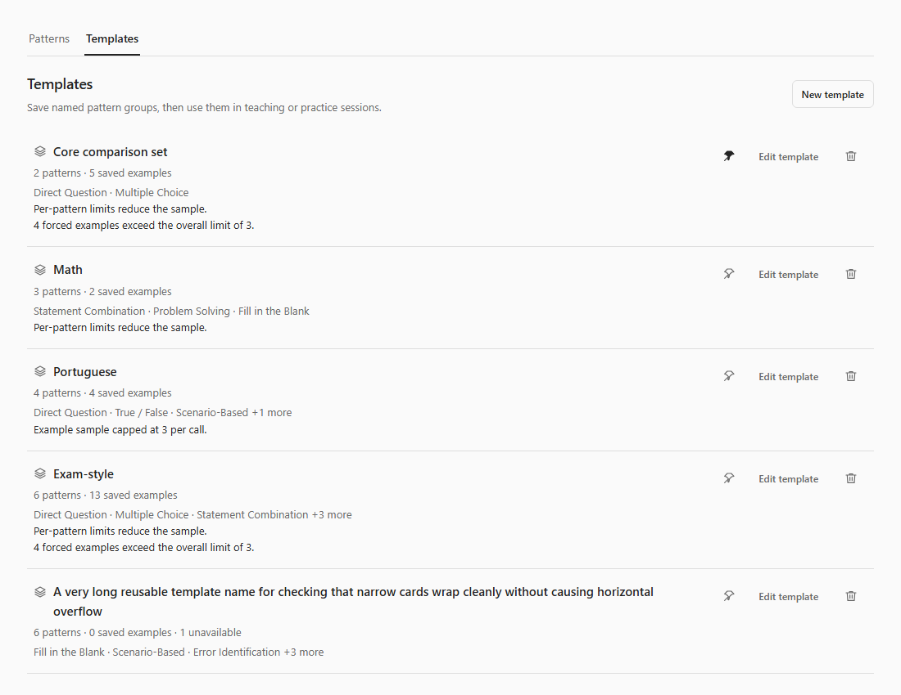
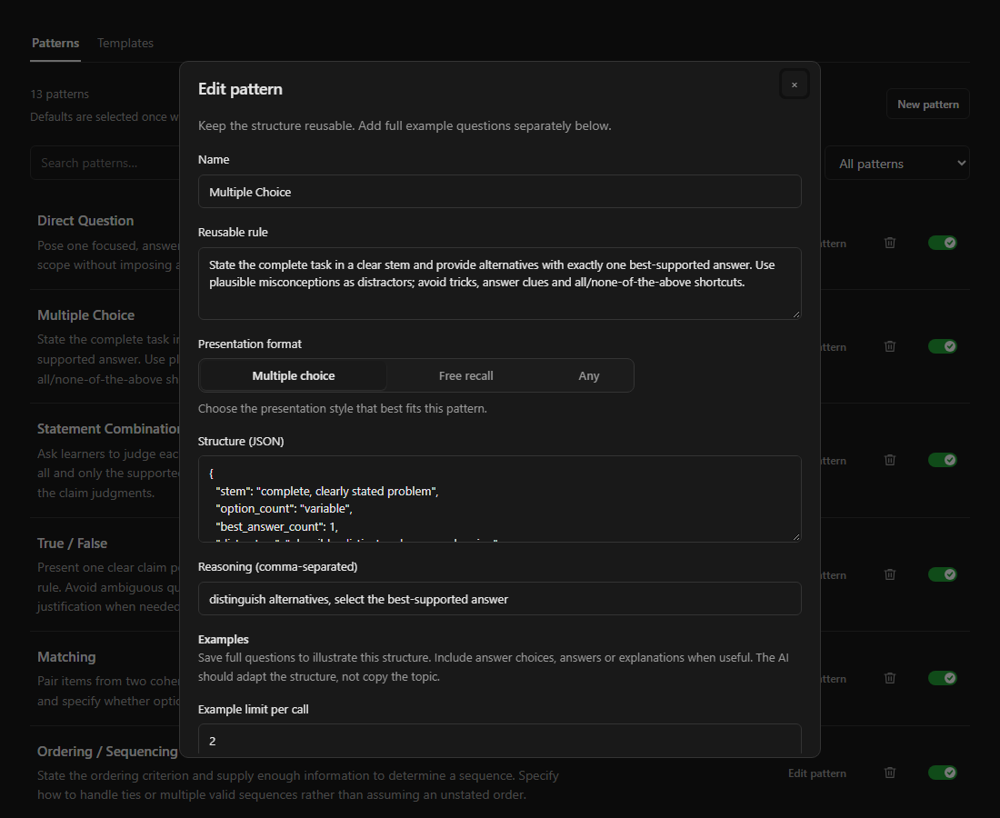
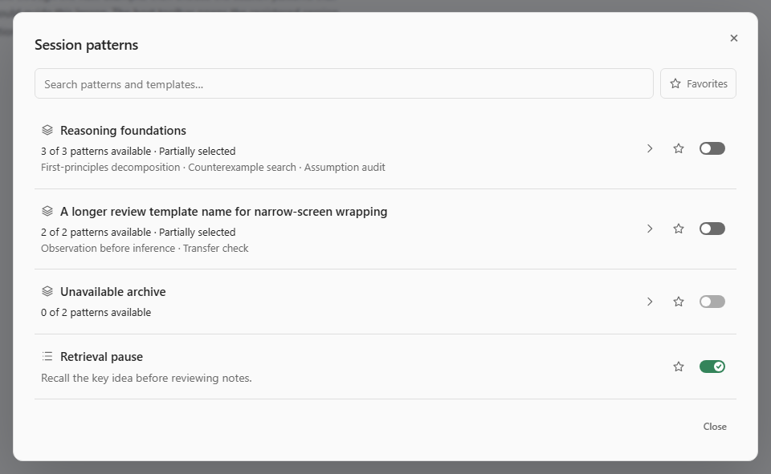

# Question Patterns

A local-first LearnHarness plugin for reusable question patterns, saved template groups, and per-session selections. Open **Patterns Library** from the sidebar to organize how questions are structured in teaching and practice sessions.

Requires LearnHarness 0.6.0 with plugin API v1. The plugin uses LearnHarness’s themes and stores its data locally.

## Install

Build from source with Node.js 22+:

```sh
npm ci
npm run build
```

Find your plugins directory in **Settings → Community plugins**, then install:

```sh
npm run install:local -- "/path/to/LearnHarness/plugins"
```

Alternatively, copy the built `dist/` folder into `<plugins-directory>/question-patterns/dist/`. Refresh Community plugins, enable Question Patterns, and restart LearnHarness to load changes to an already-loaded version.

## Workflow

**Create patterns → Group them into templates → Choose session defaults → Customize each session**

- **Patterns:** search reusable rules, edit their format and examples, and choose defaults with the green switches. Patterns whose default switches are off remain available in the session picker.
- **Templates:** save named groups such as Math, Portuguese, or Exam-style. Use the pin icon to make a group a default for new sessions. The same pattern can belong to several templates.
- **Session patterns:** search patterns and templates together, change selections, and save favorites. Session choices do not change library defaults.
- **Defaults:** applied once when a session first uses patterns. Later default changes do not replace that session’s choices, and clearing its selection stays cleared. Overlapping templates never duplicate a pattern.
- **Delete:** the trash icon opens a confirmation. Deleting a pattern permanently removes its examples, revisions, and references from templates and sessions. Deleting a template keeps its patterns and existing session selections.

## Screenshots

Browser previews of the plugin UI with fictional data and host-widget stand-ins; LearnHarness’s surrounding chrome may differ.

### 1. Browse patterns and choose defaults

Search the library, edit a pattern, or use its green switch to select it by default in new sessions. Turning it off does not hide it from the session picker.



### 2. Save templates and pin default groups

Templates group patterns for reuse. A filled pin makes the group a default for new sessions; Edit opens its full membership list.



### 3. Edit a reusable pattern

Keep the rule, presentation format and Structure JSON reusable. Full-question examples and sampling limits are configured further down the editor.



### 4. Customize one session

Search patterns and templates together, switch selections on or off, and star favorites. These choices affect only this session; the next supported submission carries its current pattern guidance to the AI.



## Patterns and examples

Patterns describe reusable question design, not a fixed subject or answer:

```json
{
  "name": "Statement Combination",
  "format": "multiple_choice",
  "structure": {
    "statement_count": "variable",
    "option_count": "variable",
    "answer_type": "statement combinations"
  },
  "rule": "Evaluate each statement independently, then select the matching truth combination.",
  "reasoning": ["evaluate_statements"]
}
```

The editor provides **Multiple choice**, **Free recall**, and **Any** presentation formats, editable Structure JSON, and comma-separated tags. Library search includes tags. Keep complete questions, choices, answers, and explanations in the separate example bank.

The library includes twelve built-in patterns: Direct Question, Multiple Choice, Statement Combination, True / False, Matching, Ordering / Sequencing, Fill in the Blank, Scenario-Based, Error Identification, Interpretation, Problem Solving, and Open-Ended Explanation. Each starts with three original English question examples and the `Core` tag.

### Example sampling

- Selected patterns normally contribute a fresh sample of **up to 3 examples** per attachment or list/set tool call.
- **Example limit per call** sets a pattern’s limit. Blank uses 3; zero disables random examples.
- **Settings → Community plugins → Question Patterns → Overall example limit** defaults to **15**, shared across non-exempt selections.
- **Force inclusion** always includes an example, even above either limit. These are example-count limits, not token budgets.
- Templates have **Bypass overall example limit** on by default. Their applied members still obey per-pattern limits, but their examples do not consume the shared overall budget.
- Numeric limits accept whole numbers from 0 to 1000. Samples contain no repeated example within a response, but later samples may repeat earlier examples.

Examples are reference material, not fixed output templates. The AI is instructed to adapt their structure to the session’s topic, difficulty, and language, use LearnHarness’s normal question tools, and keep answers out of learner-facing question text.

## Session behavior

Open **Session patterns** from the sliders icon in a teaching or practice session’s top bar. A new session starts with the union of default patterns and members of pinned default templates. Archived or missing patterns are excluded.

A template switch adds its members without clearing unrelated choices; turning it off removes those members, including shared ones. Expand a template to adjust individual members. **Use only these** replaces the session selection. Deselecting a pattern clears its template sampling exemption; selecting it manually again uses the shared budget. Template edits affect new applications, not selections already applied.

Stars save favorites independently of selection. Use **Favorites** to filter the picker; search also finds matching members inside templates.

### Automatic AI guidance

The next supported message or answer submission carries the current selected definitions and sampled examples to the AI. An empty snapshot clears older pattern guidance. Switching patterns alone does not start a model request or change a response already being generated.

Attachments are submitted reference content, not hidden system context, and may appear in the transcript. They use message content or an available, ungraded thinking channel; graded answers and structured submissions are not changed. If no permitted channel exists, or LearnHarness continues without a new submission, the AI is instructed to call `question_patterns_list` before composing questions instead. The initial diagnostic prober is not extended.

You can also ask the AI to change selections, such as “Enable Multiple Choice for this session.” `question_patterns_list` returns selected definitions; `question_patterns_list({"available":true})` lists available names and selection states for explicit discovery requests. `question_patterns_set` changes one session selection.

## Local data

LearnHarness supplies the plugin’s data directory through `ctx.dataDirectory`. Records are saved as JSON separately from the plugin code:

```text
data/
  patterns/<uuid>.json       # definitions, examples, revisions, tags, and defaults
  templates.json             # saved groups, default pins, and sampling policy
  session-selections.json    # initialized sessions, selections, and exemptions
  favorites.json             # saved pattern and template favorites
  example-settings.json      # overall sampling limit
  deleted-patterns.json      # deleted IDs; prevents built-ins from reappearing
```

Back up this directory while LearnHarness is stopped, especially before upgrading. Updates may migrate or remove obsolete plugin-owned records. Rebuilding or installing the plugin replaces code, not sibling data.

## Development

```sh
npm run check
npm run test:visual
npm run test:visual:session
```

`check` runs typechecking, tests, and the build. Browser checks use fictional data and host-widget stand-ins. They require a Chromium-compatible browser; set `EDGE_BIN` when it is not at the scripts’ default Windows Edge location. Native LearnHarness testing is separate from these browser checks.

## License

AGPL-3.0; see `LICENSE`. Includes type-only LearnHarness SDK declarations. Bundled React and TypeBox retain their license notices.
